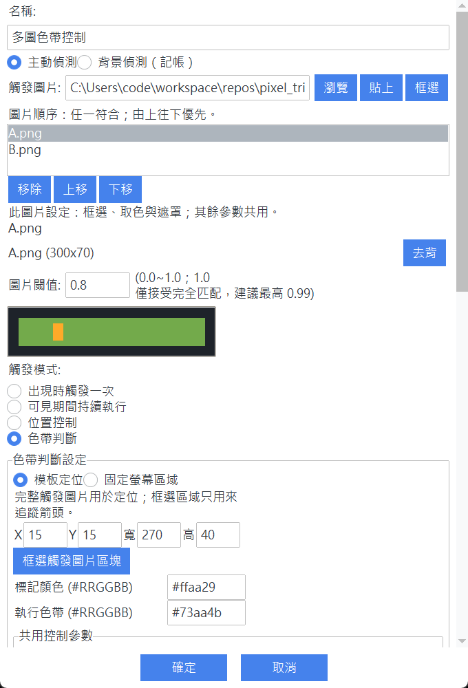
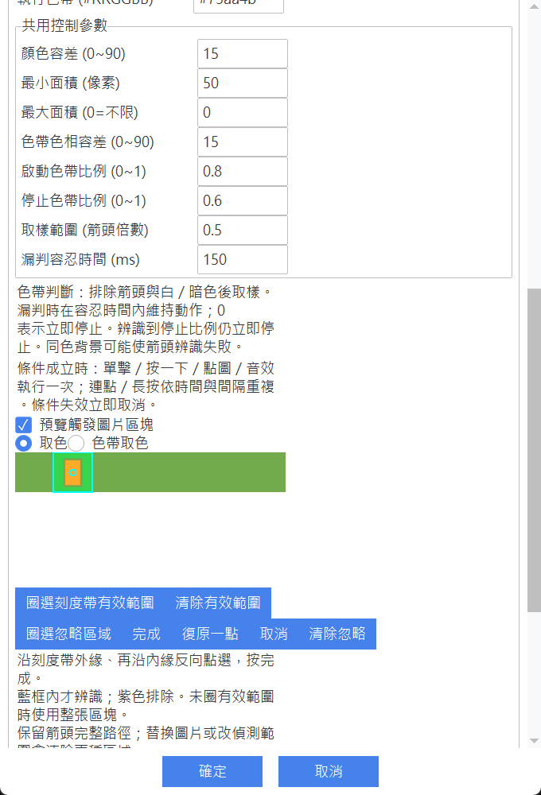

# Pixel Trigger

[English](README.md) | [繁體中文](README.zh-TW.md)

Pixel Trigger is a Windows desktop automation tool that reacts to visual
changes on screen. It combines image matching, OCR, and color tracking with
configurable mouse, keyboard, and sound actions through a Tkinter interface.

## Features

- Match images at multiple scales with OpenCV.
- Verify Traditional Chinese and English text with Tesseract OCR.
- Track colored markers and color bands inside selected regions.
- Trigger clicks, key presses, holds, rapid input, or sound alerts.
- Restrict capture to a screen region or a selected application window.
- Save reusable automation profiles as JSON.
- Choose a Traditional Chinese or English interface language.
- Record recognized balance changes in daily CSV ledgers.
- Create independent per-profile statistics from OCR balances or manual income and expenses.
- Inspect matches with logs, previews, and a click-through debug overlay.
- Package the application and OCR models for offline Windows use.

## Requirements

- Windows 10 or later
- Python 3.12 or newer
- [uv](https://docs.astral.sh/uv/)

Global hotkeys, window targeting, and input automation depend on Windows APIs.

### Recommended hardware

A recent 4-core CPU with 4 GB of RAM may handle basic detection if enough memory
remains after Windows and the target application start. For typical use, 8 GB of
RAM and an SSD are a more comfortable starting point; consider 16 GB if other
programs use substantial memory. No dedicated GPU is required. These are
guidance, not measured minimum requirements.

Detection speed depends mainly on CPU load, capture area, the number of enabled
rules, and OCR use. Scans wait 0.1 seconds by default *after* each capture cycle;
slow matching or OCR can reduce the effective rate. Select the smallest useful
capture region before shortening the scan interval. If system memory is exhausted
and Windows starts swapping, detection can slow down further.

The packaged executable does not require a separate Python installation. Running
from source requires Python and uv as listed above; text verification also needs
Tesseract and the `eng` and `chi_tra` language data.

## Getting Started

```powershell
git clone https://github.com/programzheng/pixel_trigger.git
cd pixel_trigger
uv sync --dev
uv run python main.py
```

Text verification requires Tesseract with the `eng` and `chi_tra` language
data. Development mode detects a PATH installation or the default Windows
installation. Before creating an audited offline build, run:

```powershell
uv run python prepare_tesseract.py
```

## Usage

1. Create or select a profile.
2. Choose a capture region or target window.
3. Add a combo and provide a trigger image, OCR condition, or color rule.
4. Select the action and adjust its confidence and timing settings.
5. Start or stop detection with the configured global hotkey.

Choose **繁體中文** or **English** from the language selector in the top row.
The interface switches immediately, and the choice is saved for the next launch.
Profiles and automation settings are shared between languages.

Use **Statistics** to create a manual statistic or select a background OCR combo.
Choose income, expense, net change, record count, or latest balance, then set its
period and optional limit. New records are stored under `statistics/`. Existing
`calc/` CSV files remain untouched and are not included in the new statistics.

Profiles and captured templates are stored locally in `profiles/` and
`templates/`. Both directories are excluded from version control.

## Testing

The test suite uses the Python standard library's `unittest` framework:

```powershell
uv run python -m unittest discover
```

Some UI and Windows integration behavior should also be verified manually.

## Building

Create the default Nuitka one-file executable:

```powershell
uv run python prepare_tesseract.py
uv run python build.py
```

The executable is written to `dist/pixel_trigger.exe`. Alternative build modes
are available with `--standalone` and `--pyinstaller`. The build also writes
`THIRD_PARTY_NOTICES.txt` beside the executable and exposes it from the About
window. Do not distribute a build if notice generation or dependency auditing
fails.

## Project Structure

| Path | Purpose |
| --- | --- |
| `gui.py` | Tkinter interface, editors, selectors, and debug overlay |
| `localization.py` | Traditional Chinese and English interface text |
| `automation.py` | Detection loop, trigger state, and action scheduling |
| `screen_capture.py` | Screen capture, template matching, OCR, and color detection |
| `input_controller.py` | Interruptible mouse, keyboard, and sound actions |
| `models.py` | Typed profile, combo, action, and trigger models |
| `profile_manager.py` | JSON profile persistence |
| `calc.py` | Background balance recognition and CSV ledger handling |
| `stat_tracking.py` | Statistics calculations and manual CSV records |
| `statistics_ui.py` | Statistics window and editor |
| `window_target.py` | Windows window discovery and client-area targeting |
| `test_*.py` | Unit and integration-focused regression tests |

## Contributing

See [AGENTS.md](AGENTS.md) for repository conventions, development commands,
testing expectations, and pull request guidance.

Use automation only in applications and environments where you have permission
to do so.

## Multiple trigger images

A Combo can contain an ordered list of images. Browse supports multiple selection; paste and capture add an item. Remove only removes the list entry, not the source file. Each scan uses the first matching image and runs one shared action. Switching from image A to B counts as continuous visibility; trigger-once rearms only after all images disappear.

Regions, sampled marker/band colors, include/ignore masks, and the balance number region belong to the selected image. Image confidence, OCR text conditions, color tolerance, area limits, start/stop thresholds, and missing-marker tolerance are shared. Switching images retains editor drafts; Save commits them to the Combo.

Position/color-band control selects the first matching template before evaluating its image-specific region and colors. A failed control condition does not select another image. Fixed-screen mode bypasses the image list; returning to template mode restores it. Background balance tracking reads the selected image's number region once per scan, without trying another image after an OCR failure.

Existing single-image profiles load automatically. New profiles retain first-image legacy fields, but older versions only use that image and may discard the list when saving. More images increase worst-case scan time.




